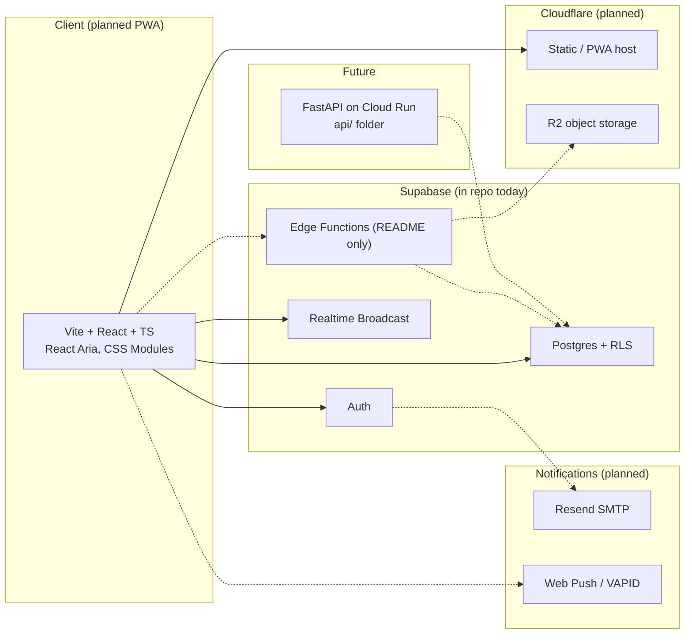

# Architecture

## Overview

Stay In Touch is a private, invite-only family social app: one family per tenant, spaces for General, each parent, and each child, with grandparents able to visit every space. The repo today is a **monorepo skeleton plus the full database layer**; the web UI, Edge Functions, media upload, email, and push are planned.

| Folder | Responsibility | Status |
|---|---|---|
| `web/` | PWA UI, Supabase client, accessibility-first components | Placeholder page only |
| `supabase/` | Migrations, seed, pgTAP tests, local CLI config | **Implemented** |
| `supabase/functions/` | Signed URLs, media status, outbox workers | README only |
| `api/` | Later AI / Python services | README only |
| `docs/` | Architecture, ADRs, build log, hosted checklist | Living docs |
| `.github/workflows/` | Web lint/build and database CI | **Implemented** |

For roles, tables, RLS, RPCs, and Realtime behavior, see the sections below. Planning ADRs are in [`docs/decisions/`](./decisions/).

---

Stay In Touch is a private, invite-only family app. One family has a General space plus one space for each parent and child. Grandparents do not get a space. Each space holds photos, videos, and one flat message thread. A message may quote-reply to another message in the same space. There is no UI for this yet. This document is the database and access model the UI will sit on.

## Stack

- Frontend: Vite, React, TypeScript (`strict`), React Aria Components, CSS Modules. No Tailwind. The app will become a PWA and move to Cloudflare later.
- Backend: Supabase only. Postgres with row-level security, Auth, Realtime Broadcast, and Edge Functions (not written yet).
- Media: Cloudflare R2 later. The database stores object keys, never URLs. A later Edge Function will mint a short-lived signed URL after an RLS check.
- Email and push later: Resend as Auth SMTP, Web Push via VAPID.
- A FastAPI service on Cloud Run is reserved under `api/` and is not built.

## Roles

Roles live on `family_members`, not on the profile and not in the JWT. One person can belong to several families.

| Role | Who | Access |
|---|---|---|
| `admin` | Both parents | See every space in the family and post in the ones that are not archived. Invite, remove, change roles, create, rename, archive, and unarchive spaces. Soft-delete anyone's post in a space that is not archived. Read `audit_log`. |
| `grandparent` | Grandparents | See and post, including photos and videos, in every space. Manage nothing. No space of their own. |
| `member` | A child | See and post only in General and their own space. They cannot see a parent's or sibling's space, including the `spaces` row. |

Everyone active can read the member list and the profiles of people who have any membership in their families, including removed members, so old posts stay attributed. A removed member sees nothing and cannot post. Their posts remain.

## Data model

UUID primary keys. `created_at` and `updated_at` on every table (`updated_at` is trigger-maintained). Content rows also carry `family_id`, kept consistent with the space by a composite foreign key and a `BEFORE` trigger.

| Table | Purpose |
|---|---|
| `families` | Tenant. Soft-deleted with `deleted_at`. |
| `profiles` | One row per auth user, created by a trigger on `auth.users`. Display name and optional avatar key. No role. |
| `family_members` | `(family_id, user_id)` unique. Role, label, `active` or `removed`. |
| `spaces` | `general` or `member`. One General per family. At most one space per owner. Owner must be in that family. |
| `messages` | Flat thread. `reply_to_id` must be in the same space. Soft delete. |
| `media` | R2 key `f/{family_id}/s/{space_id}/{media_id}/original.{ext}` and optional `thumb.jpg`. `provider` is `r2` or `mux`. |
| `invitations` | Admin-created. Pending, accepted, revoked, or expired. |
| `space_reads` | `(member_id, space_id)` and `last_read_at`. |
| `push_subscriptions` | One device row, visible only to that user. |
| `notification_prefs` | Per member, optionally per space. |
| `notification_outbox` | Server only. No client grants. |
| `audit_log` | Admins can read. Only security-definer RPCs write. |

## Enforcement

Helpers live in the `private` schema, which is not in `api.schemas` (`public` and `graphql_public` only), so PostgREST does not expose them. They are `security definer`, `stable`, and `search_path = ''`. `anon` cannot execute them. `authenticated` can execute the ones policies call, because a policy runs as the caller and Postgres checks `EXECUTE`. Each helper returns only the caller's own rows.

- `my_memberships()` — active memberships
- `viewable_space_ids()` — spaces the caller may see
- `postable_space_ids()` — viewable spaces whose `archived_at` is null. Archived spaces stay visible and reject inserts, edits, and soft-deletes for every role.
- `is_family_admin(family_id)`
- `caller_owns_member(member_id)`
- `topic_space_id()` — parses the Realtime topic GUC

Policies are one per command, `to authenticated`, and use `space_id in (select private.viewable_space_ids())` and `(select auth.uid())`. Authorization does not use JWT custom claims, so removing someone takes effect before their token expires.

Clients have no insert or update grants on memberships, invitations, spaces, or the audit log. Those changes go through security-definer RPCs that check the caller and write `audit_log`:

- `create_invitation`, `revoke_invitation`, `remove_member`, `change_member_role`
- `create_member_space`, `rename_space`, `archive_space`, `unarchive_space`
- `accept_invite` — matches the signed-in user's confirmed `auth.users.email`, uses the invitation's role, and creates a space only when the invitation says so. A `+alias` child is a separate user. A parent signs in as that child to accept. They cannot accept the invite while signed in as themselves.

`unread_counts` counts a message and the media attached to it as one item. Media with `message_id` null counts as one item on its own. The caller's own content is skipped, and a soft-deleted message drops that item.

Read RPCs are security invoker, so RLS still applies: `space_audience`, `unread_counts`, `mark_space_read`.

Authors can edit their own body or caption and soft-delete. Admins can soft-delete anyone's post and cannot change the body. A deleted post cannot be edited or restored by its author. Only an admin can clear `deleted_at`. Other members do not see a soft-deleted row. The author and the family's admins still can: Postgres checks the updated row against the select policy, so the person who deletes it has to be allowed to read it afterwards. Identity columns (`space_id`, `family_id`, author, `created_at`) cannot change after insert. Clients have no `DELETE` grant on content.

Clients cannot set server-owned columns on insert. A message cannot arrive with `edited_at` or `deleted_at` already set. Media inserted by a client is `pending` / `r2`, with no asset id or file metadata. `profiles.avatar_key`, when set, must look like `u/{user_id}/avatar/{file}`.

## Realtime

Inserts and updates of `messages` and `media` call `realtime.broadcast_changes()` on the topic `space:<space_id>`. Soft deletes are updates. The broadcast record keeps the id and the space, and omits the body, caption, and object keys. Clients refetch the row under RLS. There is no client insert policy on `realtime.messages`, so clients cannot publish.

The select policy allows `authenticated` only when the extension is `broadcast`, the row's topic equals `realtime.topic()`, and that topic is `space:<id>` for an id in `viewable_space_ids()`. Clients must subscribe with `private: true` and `supabase.realtime.setAuth()`. On a hosted project, turn **Allow public access** off.

Realtime authorizes when the client joins and keeps that decision until the JWT is refreshed or the socket reconnects. REST access ends in the same transaction as `remove_member`. A socket that was already open can still receive the minimal notice. It cannot read the post. Keep `jwt_expiry` short on the hosted project.

## Media flow (later)

The client will insert a `media` row in `pending`, upload bytes to the key stored on that row, and an Edge Function will mark it `ready` and hand out a signed URL. This handoff only stores the key.
