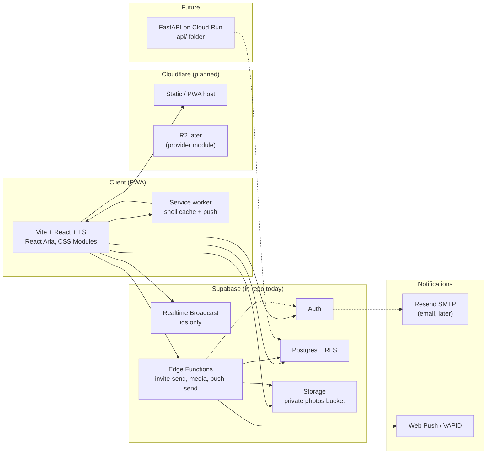
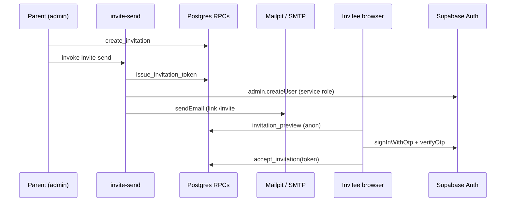
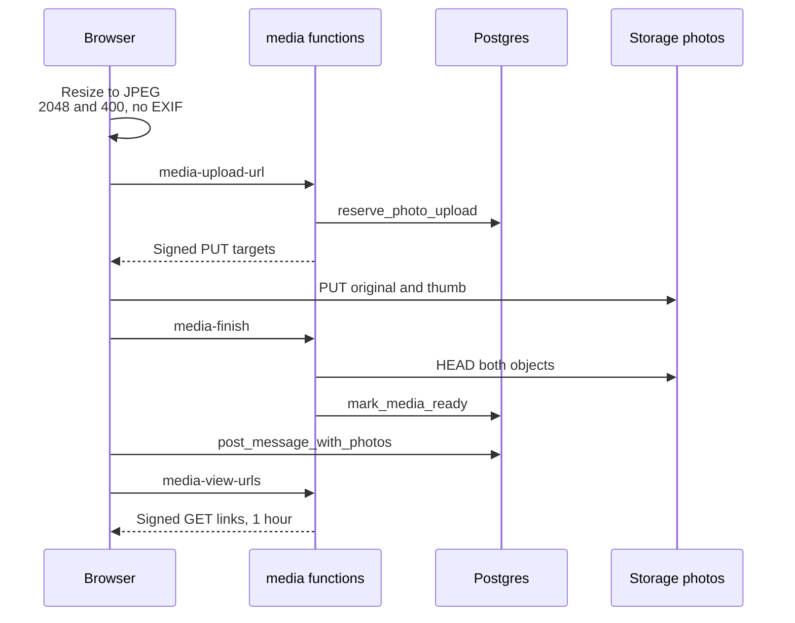
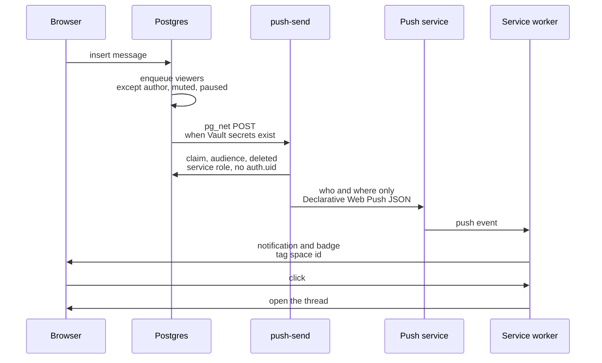

# Architecture

## Overview

Stay In Touch is a private, invite-only family social app: one family per tenant, spaces for General, each parent, and each child, with grandparents able to visit every space. The repo has the database, signed-in screens, invite email, admin tools, photo upload (handoff 05), and an installable app with web push (handoff 06). Video remains planned. Email notification digests are not built; the `email` preference column stays for later.

| Folder | Responsibility | Status |
|---|---|---|
| `web/` | PWA UI, service worker, Supabase client, accessibility-first components | **Auth, shell, threads, photos, invite, admin, install, push settings** |
| `supabase/` | Migrations, seed, pgTAP tests, local CLI config | **Implemented** |
| `supabase/functions/` | `invite-send`, media upload/finish/view/cleanup, `push-send` | **Implemented** |
| `api/` | Later AI / Python services | README only |
| `docs/` | Architecture, ADRs, build log, hosted checklist | Living docs |
| `.github/workflows/` | Web unit tests, E2E vs local Supabase, database CI | **Implemented** |

For roles, tables, RLS, RPCs, and Realtime behavior, see the sections below. Planning ADRs are in [`docs/decisions/`](./decisions/).

## Web layout (`web/src/`)

| Area | Responsibility |
|---|---|
| `app/` | `AppProviders`, `routes.tsx` (React Router 8 declarative) |
| `auth/` | Session, sign-in, `/invite`, recent accounts, callback, `RequireAuth` |
| `family/` | Families, memberships, pending invites, spaces, sibling labels, unread |
| `shell/` | `AppShell`, `SideNav`, `buildNav`, drawer, tabs, connection banner |
| `spaces/` | Space page, Members/Spaces admin, unavailable screen, audience line |
| `messages/` | Thread, composer, cache merge, realtime refetch by id |
| `media/` | Resize, HEIC fallback, upload, Pics tab, viewer |
| `pwa/` | Service-worker registration, install and permission cards, notification settings, drafts, badge |
| `settings/` | Text size control (`data-text-size` on `<html>`) |
| `ui/` | Thin React Aria wrappers |
| `lib/` | Typed Supabase singleton, TanStack Query client, query keys, errors |
| `styles/` | `tokens.css`, `base.css` (logical properties, no Tailwind) |
| `test/` | Vitest setup; `e2e/` at `web/e2e/` for Playwright |

Server state uses TanStack Query; routing does not use React Router data loaders. `AppProviders` puts React Aria's `RouterProvider` inside `BrowserRouter` so React Aria links use client navigation. Realtime calls `setAuth` before subscribing to private `space:{id}` broadcast topics for every viewable space in the active family, then refetches message rows by id under RLS. A child nav sibling is a label from `nav_child_sibling_labels`, not a space id. Unread counts and `mark_space_read` live with the family queries.

---

Stay In Touch is a private, invite-only family app. One family has a General space plus one space for each parent and child. Grandparents do not get a space. Each space holds photos, videos, and one flat message thread. A message may quote-reply to another message in the same space.

## Stack

- Frontend: Vite, React, TypeScript (`strict`), React Aria Components, CSS Modules. No Tailwind. The production build is a PWA (ADR 0077). Hosting on Cloudflare is still later.
- Backend: Supabase. Postgres with row-level security, Auth, Realtime Broadcast, Storage, and Edge Functions.
- Media: private Supabase Storage bucket `photos` for the prototype (ADR 0061). The database stores object keys, never URLs. R2 and B2 are provider modules, not wired to a bucket yet.
- Email later: Resend as Auth SMTP. Web Push is VAPID through `push-send` (ADR 0081).
- A FastAPI service on Cloud Run is reserved under `api/` and is not built.

## Roles

Roles live on `family_members`, not on the profile and not in the JWT. One person can belong to several families.

| Role | Who | Access |
|---|---|---|
| `admin` | Both parents | See every space in the family and post in the ones that are not archived. Invite, remove, change roles, create, rename, archive, and unarchive spaces. Soft-delete anyone's post in a space that is not archived. Read `audit_log`. |
| `grandparent` | Grandparents | See and post, including photos and videos, in every space. Manage nothing. No space of their own. |
| `member` | A child | See and post only in General and their own space. They cannot see a parent's or sibling's space, including the `spaces` row. |

Everyone active can read the member list and the profiles of people who have any membership in their families, including removed members, so old posts stay attributed. A removed member sees nothing and cannot post. Their posts remain.

## Data model

UUID primary keys. `created_at` and `updated_at` on every table (`updated_at` is trigger-maintained). Content rows also carry `family_id`, kept consistent with the space by a composite foreign key and a `BEFORE` trigger.

| Table | Purpose |
|---|---|
| `families` | Tenant. Soft-deleted with `deleted_at`. |
| `profiles` | One row per auth user, created by a trigger on `auth.users`. Display name and optional avatar key. No role. |
| `family_members` | `(family_id, user_id)` unique. Role, label, `active` or `removed`. |
| `spaces` | `general` or `member`. One General per family. At most one space per owner. Owner must be in that family. |
| `messages` | Flat thread. `reply_to_id` must be in the same space. Soft delete. |
| `media` | Key `f/{family_id}/s/{space_id}/{media_id}/original.jpg` and `thumb.jpg`. `provider` is `supabase`, `r2`, `b2`, or `mux`. |
| `invitations` | Admin-created. Pending, accepted, revoked, or expired. |
| `space_reads` | `(member_id, space_id)` and `last_read_at`. |
| `push_subscriptions` | One row per endpoint. Visible only to that user. Registering an existing endpoint moves it to the signed-in person. |
| `notification_prefs` | Per member, and optionally per space. `push` and `muted_until`. No client delete. |
| `notification_outbox` | Server only. One row per recipient and new post. No client grants. |
| `audit_log` | Admins can read. Only security-definer RPCs write. |

## Enforcement

Helpers live in the `private` schema, which is not in `api.schemas` (`public` and `graphql_public` only), so PostgREST does not expose them. They are `security definer`, `stable`, and `search_path = ''`. `anon` cannot execute them. `authenticated` can execute the ones policies call, because a policy runs as the caller and Postgres checks `EXECUTE`. Each helper returns only the caller's own rows.

- `my_memberships()` — active memberships
- `viewable_space_ids()` — spaces the caller may see
- `postable_space_ids()` — viewable spaces whose `archived_at` is null. Archived spaces stay visible and reject inserts, edits, and soft-deletes for every role.
- `is_family_admin(family_id)`
- `caller_owns_member(member_id)`
- `topic_space_id()` — parses the Realtime topic GUC

Policies are one per command, `to authenticated`, and use `space_id in (select private.viewable_space_ids())` and `(select auth.uid())`. Authorization does not use JWT custom claims, so removing someone takes effect before their token expires.

Clients have no insert or update grants on memberships, invitations, spaces, or the audit log. Those changes go through security-definer RPCs that check the caller and write `audit_log`:

- `create_invitation`, `revoke_invitation`, `issue_invitation_token`, `accept_invitation`, `accept_invite`, `invitation_preview`, `my_pending_invitations`, `remove_member`, `change_member_role`
- `create_member_space`, `rename_space`, `archive_space`, `unarchive_space`
- `accept_invite` — matches the signed-in user's confirmed `auth.users.email`, uses the invitation's role, and creates a space only when the invitation says so. A `+alias` child is a separate user. A parent signs in as that child to accept. They cannot accept the invite while signed in as themselves.

`unread_counts` counts a message and the ready photos attached to it as one item. Pending and failed media never count. Unattached ready media counts as its own item. The caller's own content is skipped, and a soft-deleted message drops that item.

Read RPCs are security invoker, so RLS still applies: `space_audience`, `unread_counts`, `mark_space_read`.

Authors can edit their own body or caption and soft-delete. Admins can soft-delete anyone's post and cannot change the body. A deleted post cannot be edited or restored by its author. Only an admin can clear `deleted_at`. Other members do not see a soft-deleted row. The author and the family's admins still can: Postgres checks the updated row against the select policy, so the person who deletes it has to be allowed to read it afterwards. Identity columns (`space_id`, `family_id`, author, `created_at`) cannot change after insert. Clients have no `DELETE` grant on content.

Clients cannot set server-owned columns on insert. A message cannot arrive with `edited_at` or `deleted_at` already set. Clients cannot insert `media` directly. `reserve_photo_upload` creates the pending row. `profiles.avatar_key`, when set, must look like `u/{user_id}/avatar/{file}`.

### Invite flow (handoff 04)

`invitations.token_hash` is never granted to clients. Resend rotates the hash. Revoke keeps the hash and sets `status = 'revoked'`, so the old link can say the invitation was cancelled while accept still fails. `invite-send` creates the auth user with the email already confirmed (ADR 0060) because signup is closed. `private.cleanup_orphan_invite_auth_users` runs on a daily pg_cron schedule when the extension is available.

Admin UI routes: `/f/:familyId/members`, `/f/:familyId/spaces`. Public accept route: `/invite` (token in fragment).

## Realtime

Inserts and updates of `messages` and `media` call `realtime.send` on the topic `space:<space_id>`. Soft deletes are updates. The payload record is `{ id, space_id }` plus `table` and `operation`. `realtime.send` also adds its own broadcast id. Body, caption, and object keys are absent. Clients refetch the row under RLS. A media notice also refreshes the Pics tab. There is no client insert policy on `realtime.messages`, so clients cannot publish.

The select policy allows `authenticated` only when the extension is `broadcast`, the row's topic equals `realtime.topic()`, and that topic is `space:<id>` for an id in `viewable_space_ids()`. Clients must subscribe with `private: true` and `supabase.realtime.setAuth()`. On a hosted project, turn **Allow public access** off.

Realtime authorizes when the client joins and keeps that decision until the JWT is refreshed or the socket reconnects. REST access ends in the same transaction as `remove_member`. A socket that was already open can still receive the minimal notice. It cannot read the post. Keep `jwt_expiry` short on the hosted project.

## Photos (handoff 05)

Limits, enforced in SQL: JPEG, 5 MB per file, 10 photos per post, 100 media rows per member per rolling day, 800 MB app-wide (`private.app_limits`). `reserve_photo_upload` holds advisory lock `83427601` until the transaction ends. The reservation stores `media.provider` from `MEDIA_PROVIDER` (default `supabase`). Pending and failed rows are visible only to the uploader. A blank message is allowed only while a photo is attached; deleting its last photo soft-deletes the message. Signed view URLs are reused for about 50 minutes. storage-api's signed GET sends `Expires` at the token end and does not echo the object's `Cache-Control`.

Provider modules live in `supabase/functions/_shared/media/`. `MEDIA_PROVIDER=supabase` is the tested path. `r2` and `b2` share the S3 module and are unit-tested only.

`media-cleanup` runs with `x-media-cleanup-secret` and deletes orphan objects older than 24 hours, including soft-deleted uploads that were never attached to a message. Attached photos stay so an admin can restore them. The Video tab is hidden. `/video` redirects to messages.

## Install, offline, and push (handoff 06)

The production build registers `web/src/sw.ts` (Workbox `injectManifest`). `pnpm dev` does not. The worker precaches the app shell only: HTML, JS, CSS, fonts, and icons. It does not precache the lazy `heic-to` chunk and it does not cache Supabase REST, RPC, Auth, Realtime, Functions, or Storage. A navigation falls back to `index.html` except `/auth/`, `/functions/`, `/rest/`, and `/storage/`. Preview sends `Cache-Control: no-cache` for `sw.js` and `index.html`. A waiting worker shows "A new version of Stay In Touch is ready" and does not reload while the composer has text or a photo upload is in progress. Later hides that prompt until the next app open or a newer worker. Only the tab that presses Update now reloads.

Offline, the connection banner stays and the composer stays. Send is disabled. The draft text is in `localStorage` for that person and space. It is written when the person leaves the space and when the composer unmounts, and it is cleared on send and on sign-out. Sign-out suspends draft writes first. Photos are not kept across a reload.

`/f/:familyId/notifications` is linked next to text size. It can turn this device on or off, turn all notifications off, pause for 8 hours or until 07:00 Asia/Jerusalem, and mute one visible space. Pause and the all-off switch take `p_family_id` because one person can belong to more than one family (ADR 0015).

A one-minute `pg_cron` sweep retries rows the immediate call missed, and deletes sent, skipped, and failed rows older than 7 days. Both the trigger's HTTP call and the sweep run only when Vault holds `push_send_secret` and `push_send_url`. The sender is `PushSender`: `webpush` (`@negrel/webpush`) or `capture`. A 404 or 410 deletes the subscription. 429 and 5xx back off 1, 5, then 15 minutes and stop after 4 attempts. 400 and 413 are failed and are not retried once another device has accepted the row. No remaining device is `skipped` / `no_device`. A deleted post is `skipped` / `deleted`. `push_deliveries` remembers which subscription accepted which rows, so a retry does not send the same row to a device that already returned 201.

Enqueue still calls `private.space_viewer_member_ids`, which needs the author's session. Send-time and `private.unread_total` call `private.space_audience_member_ids` (ADR 0094). That function is not granted to clients. An insert with no JWT still enqueues nobody.

The push module is `supabase/functions/_shared/push/`. Client RPCs, granted to `authenticated`: `register_push_subscription`, `unregister_push_subscription`, `set_space_muted`, `set_notifications_enabled`, `set_notifications_paused`, `my_notification_settings`. Service RPCs, granted to `service_role`: `claim_push_batch`, `push_group_facts`, `record_push_result`, `record_push_delivery`, `delivered_push_subscriptions`, `prune_notification_outbox`, `unread_total`.

While the app is open, `setAppBadge` uses that family's unread total and clears at zero. The push payload's `app_badge` is `private.unread_total` across families. The worker applies that count, and shows the app icon and the monochrome badge. Turning this device off is remembered in `localStorage` and blocks the next automatic subscribe. A subscription on a retired VAPID key is replaced on the next open.

## Media flow (later)

Video storage is not chosen. R2 or B2 can replace the Supabase bucket by changing `MEDIA_PROVIDER` and copying objects. The database already stores keys only.
